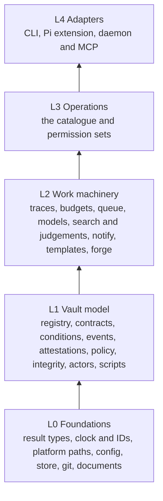

# Implementation plan

How to build pi-active-vaults from the design in `docs/`. Written for the agent
doing the implementation. A reviewer who took part in the design reviews the
work at the checkpoints below, against the documentation and this plan — so
make the work easy to review: small commits, clear messages, and an honest
progress log.

## Ground rules

- The human documentation is the specification. This plan says *how* to get
  there; it never overrides `docs/`.
- Work on branch `impl/v1`, created from `main`. Never commit to or merge into
  `main`.
- Build bottom-up through the layers below. Do not start a layer until the one
  beneath it is tested and refactored.
- Each stage: tests first, then implementation, then a refactoring pass, then a
  progress-log entry. Run the full test suite and type check before every
  commit.
- Prefer a smaller, complete, well-factored stage over a broad, partial one.

## Layers

A module imports only from its own layer or lower ones, and the core
(`L0`–`L3`) never imports an adapter. Enforce this with a test that reads the
import graph — written in Stage 0, so every later stage is held to it.

The module names and responsibilities are those in
`docs/components/core.md`. If the implementation wants a different split,
propose a documentation change rather than diverging silently.

## Stages

| Stage | Builds | Done when |
|---|---|---|
| **0. Scaffold** | `package.json` (Node ≥ 22.18, ESM, `pi` manifest, `vault` bin, Pi packages as peer dependencies), TypeScript strict with `erasableSyntaxOnly` so tests run directly under Node's type stripping, `npm test` (`node --test`) and `npm run check` (`tsc --noEmit`); the layer-import test; shared test support: temporary Git repositories, an injectable clock and ID source, a local HTTP stub server | `npm test` and `npm run check` pass on an empty core |
| **1. Foundations** (L0) | Result and error types; clock and IDs (time-sortable trace IDs); platform directories for Linux, macOS and Windows; installation config with secret resolution; `store` with migrations and transactions; `git`; `documents` | Each module's documented behaviour is tested, including each platform's path branch |
| **2. Vault model** (L1) | `registry`, `contracts` (all five merge strategies, key origins), `conditions`, `events`, `attestations`, `policy` (including the owner floor for control changes and `when-tainted`), `integrity` (accepted `main`, unaccepted-change detection, adopt), `actors` (worktrees, review, SHA-bound accept, trailers), `scripts` (headers, built-in namespace, resolution from the accepted `main`, interpreter handling per platform) | All security behaviours of these modules have fail-closed tests; whole-codebase consolidation pass done |
| **3. Work machinery** (L2) | `traces` (compact records, provenance, log rotation), `budgets`, `queue`, `models` (batch × parallel; the three role APIs), `search` (FTS5, `sqlite-vec`, rank fusion, rerank, freshness verdicts), judgements, `notify`, `templates`, `forge` (one adapter interface; Gitea, GitHub and GitLab against stub servers) | Each module tested without network; search degrades to keyword-only without an embedding model |
| **4. Operations and CLI** | `operations` catalogue and permission sets; the `vault` CLI generated from it, plus CLI-only commands (`init`, `doctor`, `daemon …`, `whoami`) | Every documented command works against temporary vaults; the unaccepted-change notice appears on every command |
| **5. Pi extension** | Tools generated from the catalogue, `vault_fan_out`, commands, flags, hooks (write guard, session events, injection, taint, budgets), events | Tested against Pi's SDK in-memory sessions from the dev-dependency, not a global Pi |
| **6. Daemon and MCP** | Git-event monitoring and polling, timers and catch-up, matching, claims, scheduler, execution via `pi --mode rpc` (a fake `pi` in tests), forge sync, outbox retry, log rotation, socket protocol, MCP profiles (HTTP and standard I/O), service definitions per platform | Spawn lifecycle and crash recovery tested; MCP permission evaluation tested exhaustively |
| **7. End to end** | Scenario tests across components: a scheduled job producing a proposal; accept and adopt; an unaccepted change pausing automation; a forge-mode proposal against a stub forge; an MCP read-only profile | Scenarios pass; final consolidation pass done |

## The loop inside each stage

1. Re-read the documents the stage implements.
2. Write tests for the documented behaviour — including the fail-closed cases
   AGENTS.md lists — and commit them (`test(<module>): …`).
3. Implement until they pass; commit in coherent steps.
4. Refactoring pass (below); commit as `refactor: …` with a body saying what
   changed and why.
5. Update `docs/agents/progress.md`; commit.

## Refactoring passes

At the end of every stage, and as a **whole-codebase consolidation pass** after
Stage 2 and again after Stage 7. The aim: every concept can be understood on its
own, and every composition visibly follows from the purposes of its parts — so
a reader can see that the code implements the design.

Check, and fix:

- **One home per concept.** Each concept in `docs/concepts.md` and each module
  in `docs/components/core.md` has exactly one implementation. Search before
  adding a function; generalise rather than copy.
- **Readable in isolation.** Each module's header states its responsibility and
  invariants; its exported surface is small; its names are the documentation's
  vocabulary (*accepted `main`*, *effective contract*, *attestation*, *actor*,
  *proposal*, *spawn*, *trace*).
- **Composition is visible.** Higher-level functions read as compositions of
  lower-level concepts — for example, accepting is policy over attestations,
  then a Git merge, then recording the accepted `main` — not as re-implementations
  of them.
- **Dependencies point down.** The layer test passes; no cycles.
- **Adapters stay thin.** No decision logic outside the core.
- **Tests mirror the design.** Test names describe documented behaviours;
  shared setup lives in test support, not copied between files.
- **Nothing stale.** Comments, names and documentation match the behaviour;
  dead code is removed.

## When the documentation is unclear or wrong

- **Ambiguous:** choose the simplest interpretation consistent with
  `docs/principles.md` and `docs/security.md`, and record it under *Decisions*
  in the progress log.
- **Wrong or incomplete:** do not silently diverge. Propose the documentation
  change in its own commit (`docs: propose …`) and list it under *Needs owner
  approval* in the progress log. Never weaken a principle or a security
  guarantee.
- **Blocked:** stop and ask.

## Dependencies

Pre-approved when a stage needs them: a YAML parser (frontmatter and config),
`sqlite-vec`, `nodemailer`, the MCP SDK (`@modelcontextprotocol/sdk`), a cron
expression parser, and Pi (`@earendil-works/pi-coding-agent` ≥ 1.3) as a dev
dependency for types, its shipped documentation and SDK-based tests. Anything
else needs a one-line justification in the commit message and the progress log.

## Testing notes

- No network and no real vaults: temporary repositories, local stub servers for
  model endpoints, forges and SMTP (with a test certificate so TLS and STARTTLS
  enforcement are real), and a fake `pi` executable for daemon execution.
- Windows and macOS branches are tested through injected platform values;
  anything that can only be verified on a real platform is listed in the
  progress log.
- Time is injected; no sleeps.

## Checkpoints

**Every stage ends at a checkpoint.** At the checkpoint:

1. Make sure all tests and the type check pass.
2. Complete the stage's entry in `docs/agents/progress.md` — every field of the
   template, including the commit range and the test and check results — and
   commit it as the stage's last commit.
3. Stop, and reply with a short summary: the stage, the last commit, whether
   tests and checks pass, and anything that needs the owner's decision. The
   progress log holds the full report; do not repeat it.

Do not start the next stage until told to.

Review findings arrive as instructions for the next session; address them
before starting the stage they are given with.

## Sessions

Each stage may be done by a fresh session, possibly with a different model. The
progress log and this plan are the handoff: a new session reads AGENTS.md, this
plan, the progress log, and the documents its stage implements, then continues
from the recorded state. If context runs short mid-stage, finish the current
step, commit, and update the progress log so another session can resume.
