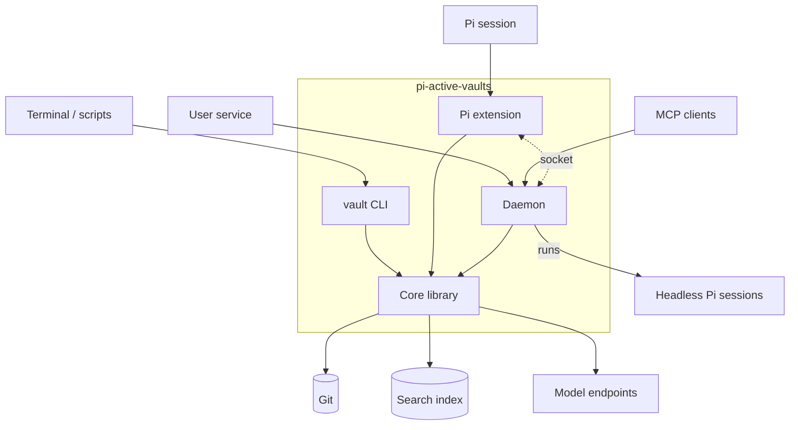
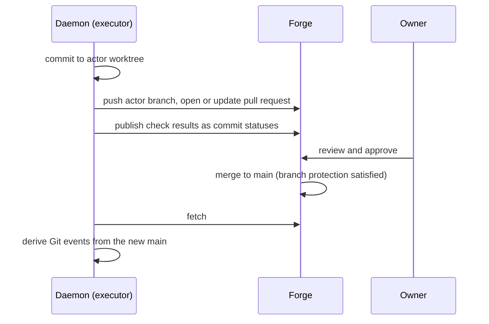

# Architecture

One npm package, installed with `pi install`, containing four parts that share a
core library.



The daemon runs headless sessions as `pi --mode rpc`; the socket between the
extension and the daemon is optional.

## Components

| Component | Runs as | Responsible for |
|---|---|---|
| [Core library](components/core.md) | In-process in each of the others | Every vault operation: documents, contracts, conditions, policy, attestations, actors, scripts, traces, budgets, search |
| [CLI](components/cli.md) | `vault` on the command line | Human and script access to every operation |
| [Pi extension](components/extension.md) | Inside each Pi session | Tools, injected context, write guarding, session events, commit trailers |
| [Daemon](components/daemon.md) | A user service | Timers, Git-event monitoring, the spawn queue and scheduler, trace logs, forge sync, the MCP server |

The extension and CLI never need the daemon for reading, searching, reviewing or
accepting. The daemon adds work that must happen while nobody is using Pi.

## Process model

- The **extension** lives only as long as its Pi session. It starts nothing in
  its factory; resources start on `session_start` and stop on
  `session_shutdown`.
- The **daemon** is one process per machine, installed as a user service. It
  runs agent sessions by starting `pi --mode rpc` subprocesses, so headless runs
  use the user's own Pi, models and configuration, and load the same extension.
- The **CLI** is a short-lived process. It talks to the daemon when one is
  running and works directly against the core otherwise.

## Data locations

| Data | Location | Shared via Git |
|---|---|---|
| Documents, contracts, jobs | Vault working tree | Yes |
| Scripts, checks, compact traces | `.vault/` in the vault | Yes |
| Attestations | `refs/notes/vault/attestations` | Yes |
| Proposals | Actor branches (`actor/<name>`) | Yes, for shared vaults |
| Actor worktrees | Per vault, configured in the installation | No |
| Installation config | `<config>/config.yaml` | No |
| Durable machine state | `<state>/state.sqlite` | No |
| Search index | `<state>/index.sqlite` | No |
| Full trace logs | `<state>/logs/<date>/<trace-id>/` | No |
| Daemon socket | Unix domain socket in `<state>`; a named pipe on Windows | No |

`<config>` and `<state>` are the platform's own directories for the
`pi-active-vaults` application:

| Platform | `<config>` | `<state>` |
|---|---|---|
| Linux | `$XDG_CONFIG_HOME` (`~/.config`) | `$XDG_STATE_HOME` (`~/.local/state`) |
| macOS | `~/Library/Application Support` | `~/Library/Application Support` |
| Windows | `%APPDATA%` | `%LOCALAPPDATA%` |

`PI_ACTIVE_VAULTS_CONFIG` and `PI_ACTIVE_VAULTS_STATE` override them. Files and
the socket are accessible only to the user.

## Local storage

Everything a vault shares lives in Git. Everything local to a machine lives in
**SQLite**, in two files of the same engine, separated by lifecycle:

| File | Holds | Lifecycle |
|---|---|---|
| `state.sqlite` | Accepted `main` per vault, spawn queue and claims, job cursors, run state, budget ledger, review records, notification outbox, judgement cache | Durable; never deleted by the package |
| `index.sqlite` | Chunks, keyword index (FTS5), vectors (`sqlite-vec`), content hashes, the embedding model it was built with | Derived from Git; safe to delete and rebuild |

- **One access path.** Only the core's `store` module opens these files.
- **Atomic.** Every multi-step change is a single transaction started with
  `BEGIN IMMEDIATE`. A claim is a unique insert; a second claim for the same
  spawn fails inside the database.
- **Durable.** Write-ahead logging; `synchronous=FULL` for `state.sqlite`,
  `NORMAL` for the rebuildable index.
- **Concurrent.** The daemon, CLI and every Pi session may open the files at
  once; each connection sets a busy timeout and keeps transactions short.
- **Versioned per module.** Each module owns the migrations for its own tables;
  the file records the version reached by each module and applies pending
  migrations on open. A file from a newer version of any module is refused.
- **Local disk only.** SQLite's write-ahead log is unsafe on network
  filesystems; the state directory must be local.

Full trace logs stay as plain files, because they are rotated and compressed by
age.

## Runtime flows

### Interactive session

1. Pi loads the extension. On `session_start` it reads the installation config,
   compiles the vault catalog and registers tools.
2. The model searches and reads vault content through the vault tools.
3. When the session reads or edits a governed path, the extension injects the
   effective contract and any matching `inject` documents.
4. Edits go to the session's actor worktree. The write guard blocks paths the
   actor may not change.
5. Commits carry trace and session trailers. Matching `spawn` conditions are sent
   to the daemon, or queued in the state database if it is not running.

### Change-triggered work

1. A commit or merge updates a ref. A Git hook notifies the daemon, which also
   polls refs as a fallback.
2. The daemon diffs from each job's cursor up to the accepted `main`, matches
   `applies-when` conditions and claims each spawn in the state database. If
   `main` has an unaccepted change, the vault's automation pauses instead.
3. The scheduler runs the spawn under its budget — forking from the originating
   session when it is available and the job allows it.
4. The session commits to its actor branch; the cursor advances; the trace is
   recorded.

### Timer

The daemon evaluates timer conditions each minute. Runs missed while it was down
follow the condition's `missed` setting.

### Review and accept

In `local` review mode:

1. `vault review <vault> <actor>` shows commits, diff, check results and flags for
   control changes, and records the SHA reviewed.
2. `vault accept` gathers attestations for that SHA, evaluates the merge policy,
   merges only that SHA and records the result as the accepted `main`. It
   refuses if the branch has moved.
3. The merge produces Git events that may trigger further work.

In `forge` review mode — for example a headless server proposing to a vault
whose owners review in a forge UI:



## Scheduling

Model capacity is configured per model (`parallel`). The scheduler orders queued
requests:

1. Work that another session is waiting on.
2. Work started by a trigger's original session before the follow-ups it caused.
3. Earlier roots before later ones.

## Degradation

| Capability | Without the daemon |
|---|---|
| Search, read, contracts, review, accept | Available |
| Injection, write guard, scripts | Available in Pi sessions |
| Fan-out | Runs sequentially in the session |
| Triggered spawns | Queued in the state database; run when the daemon starts or on `vault run` |
| Timers and Git-event jobs | Caught up on daemon start |
| Search without an embedding model | Keyword search only, reported as such |

## Repository layout

```
src/
  core/        shared library
  cli/         vault entry point and commands
  extension/   Pi extension entry point
  daemon/      service, scheduler, socket server
test/          unit and integration tests, mirroring src/
docs/
```

## Technology

- TypeScript, compiled with `tsc`. Pi loads the compiled extension.
- Node.js ≥ 22.18: the built-in `node:sqlite` for all local storage (no native
  dependency to build; extension loading needs this version), `node:test` for
  tests.
- `sqlite-vec`, loaded as a SQLite extension from its prebuilt per-platform
  packages, for vector search; FTS5 for keyword search.
- The `git` command line for all Git operations.
- Minimal runtime dependencies; each one needs a stated reason.
