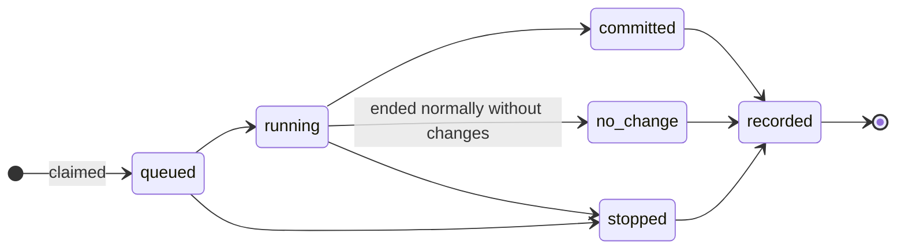

# Daemon

Runs the work that must happen while nobody is using Pi: timers, reactions to
Git changes, and queued spawns. One per machine, as a user service.

## Responsibilities

| Area | Behaviour |
|---|---|
| **Single instance** | Takes the daemon's record in the state database (process ID and start time, void once that process ends), then binds its socket. If another daemon holds either, it exits `0`, so a service manager does not restart it |
| **Git events** | Each vault's `reference-transaction` hook leaves a file named after the vault in `<state>/refs`; refs are also polled every minute |
| **Timers** | Evaluated each minute in the machine's time zone. A run is identified by its local date and scheduled time, so a daylight-saving change neither repeats nor skips it; `missed` applies on start |
| **Integrity** | On every ref change, checks for an unaccepted change; pauses that vault's automation and tells its owners once per unaccepted tip. For each vault it runs, a trial merge finds any writer's branch that could not be brought up to date with the accepted `main` because the merge would conflict, and tells the owners once per branch head and accepted `main`: which files, and how to resolve it |
| **Matching, claims, scheduling** | Below |
| **Budgets** | Document budgets, cascade pools and the daily ceiling |
| **Traces** | Trace IDs, full logs, rotation |
| **Outbox** | Each minute, retries due notifications with backoff ([Notifications](../notifications.md)) |
| **Forge sync** | Below |
| **Index upkeep** | Below |
| **MCP server** | Serves each MCP profile that has an endpoint; one that cannot be served (unresolved token, address in use) is reported and the rest still are ([MCP](../mcp.md)) |

## Spawn lifecycle



A spawn's identity is its document and the event that triggered it. Claiming
it is a unique insert, made before anything runs, so no spawn runs twice. Each
state change is one transaction.

| Stop reason | When |
|---|---|
| `budget`, `ttl` | Its budget or run time is used up |
| `error` | Its process failed, or its last model request ended in an error |
| `restart` | The daemon restarted while it ran |
| `queue-time` | Queued longer than `daemon.queue-time` |
| `requested` | Stopped through the socket |
| `no-session` | Its condition is `session-required` and the originating session is not known here |
| `no-model` | No `agent` model it may use: none configured, or not allowed by `policy` for its vault — decided at the claim, and again when it would start |
| `out-of-date` | Its actor's branch could not be brought up to date with the accepted `main` before the run; `vault sync <actor>` resolves it |

## Matching

Each job has a cursor per event stream: merges on the accepted `main`
(`merged`) and commits on each actor branch (`committed`). Events after the
cursor are matched, their spawns claimed and the cursor advanced, one event at
a time. Events come from Git history, so nothing is lost while the daemon is
down: on start it catches up from each cursor.

- A new job starts at the merge that introduced it. In a vault the daemon
  newly takes up, every cursor starts at the current history, so nothing
  earlier is replayed. A new actor branch starts where it left the accepted
  `main`.
- A paused vault's cursors wait until it is resolved.
- An event is matched in parts, one per run whose changes it holds (by
  `Vault-Trace`). Each part continues that run's session tree if the run is
  known here, else starts a new one; changes no run made start a new tree.
  Each part is a spawn identity of its own.
- A cursor whose commit has gone (rewritten history) restarts at the tip.

## Scheduling

Queued spawns start in the order of [Architecture](../architecture.md#scheduling),
at most `daemon.parallel` at a time, and one per actor. A spawn's actor is the
job's `actor`, and its model the job's `model` (else the default `agent`), both on
the accepted `main` at claim time. A spawn with no `agent` model it may use —
none configured, or not allowed for its vault by `policy` — is stopped with
`no-model` and reported by `vault doctor`. While the spawn's actor is running
a job, claimed by an earlier spawn or held by an interactive session, the
spawn waits in place. Nothing starts in a paused vault.

```yaml
daemon:
  queue-time: 24h   # default
  parallel: 1       # default: headless sessions at once, the capacity of Pi's model
```

## Execution

A spawn runs in its actor's worktree as

```
pi --mode rpc --model <agent model> --vault-run <state>/runs/<trace>.json --session-id <trace> [--fork <session file>]
```

Before starting Pi, it brings the actor's branch up to date with the accepted
`main`, as `vault sync` does: a merge, so the branch keeps its own unaccepted
work and gains what the owner changed on `main`. A branch that cannot be
brought up to date (a conflict, uncommitted changes) is stopped `out-of-date`
and Pi is not started; for a conflict, its log says which files and how an
owner resolves it.

When the job has a `web` block, it then asks the signer named in
`web-grants.signer` for the run's grants, naming the vault, the job and the
trace, and puts them in the run file ([Web grants](../concepts.md#web-grants)).
It never signs grants itself. A run the signer refuses, or cannot be asked
about, starts without grants, and its log says why.

It forks the originating session when that session subscribed here (giving
its file) and the condition's `context` is not `bare`. The daemon records the
process (ID and start time) first, starts the session, waits for Pi to settle
and closes its input; a run still going a minute past its `ttl` is killed.

The outcome comes from what was recorded: commits carrying the run's trace
make it `committed` (a later model error is noted in its log); otherwise a stop
reason above applies; a run that settled normally without committing is
`no-change`. The run's full log holds the daemon's steps and Pi's events
(without streaming deltas).

## Start-up recovery

Only one daemon runs, so nothing it started can still legitimately be running
when it starts. Before anything else it:

1. Ends headless sessions left from its previous run, by recorded process ID
   after checking the start time, so a reused ID is never touched. It never
   matches processes by name.
2. Stops every running spawn with `restart`, ending its budget session and
   releasing its actor.
3. Resets those actors' worktrees to their last commit, saving uncommitted
   changes to the run's full log first.
4. Leaves queued spawns queued.

Interactive sessions are not the daemon's; their holds stand while their
processes live. `vault doctor --fix` runs the same recovery when no daemon
runs, so for anything the daemon owns, restarting it is the remedy.

## Hosting

Two settings decide which daemon runs a vault's timer and Git-event jobs:

| `vault.executor` (root contract) | Runs on this installation when |
|---|---|
| unset | its `host: true` (installation config; default `false`) |
| this installation's name | always |
| another installation's name | never — `vault doctor` warns if `host: true` is set |

So nothing runs until someone opts in, and a vault can be pinned to one
machine however many clone it. An installation's name defaults to
`<user>@<hostname>`; `vault whoami` prints it. Spawns from an interactive
session run on that session's machine.

## Forge sync

Each minute, every `forge`-mode vault is fetched first: the forge's `main`
becomes the accepted `main`, the local `main` follows it forward, and merges
are matched like any other. For the vaults this daemon runs, and for the
person's own proposals:

- **Proposals.** Each of the vault's `actors` with a proposal is judged for
  what its merge policy still needs, then kept current:
  when its head moves, the branch is pushed and its pull request opened or
  updated with its statuses; otherwise the statuses are evaluated again every
  five minutes, to pick up reviews made in the forge — every minute while all
  it waits for is an owner's approval — and published only when one changed.
  With each new head the forge is asked to merge the pull request once it is
  approved and its checks pass (security-setup.md "Merging once approved"); a
  refusal is asked again each pass until the forge accepts. Failures show in
  `vault daemon status` and are retried the next minute.
- **The person's own proposal**, in every forge-mode vault they write to —
  run here or not. It is never pushed from here: proposing is theirs (`vault
  propose`). Once the forge has a pull request holding it, its statuses are
  kept current the same way. Statuses are only ever published on the head the
  pull request holds, so work committed since is not reported on until it is
  proposed.
- **Merge results.** Before fetching, it asks the forge for the most recently
  merged pull requests (one page); after fetching, it checks once whether each
  one's head is in the new `main`. One that is not — a squash or rebase merge —
  is reported once to the owners, naming the pull request and that its
  attestations and trace notes no longer attach.
- **Branches after a lost merge.** The daemon resets the actor branch to the
  accepted `main` only if its tip is exactly the approved head, no session
  holds the actor and its worktree has no change (untracked files included).
  Otherwise the report names the condition and the command to run (`git -C
  <worktree> reset --hard main`, or `git -C <vault> branch -f actor/<name>
  main` without a worktree). While the branch holds the approved head, `vault
  status` and `vault doctor` list the merge and no new pull request is opened;
  the listing ends by itself once it no longer does.
- **Pushes.** Never forced, with one exception: after such a reset, the
  forge's copy still holds the merged head, so the push replaces exactly that
  commit (`--force-with-lease` on it), and is refused if the copy is anything
  else. `main` is never pushed.

Attestation and trace notes are fetched, merged line by line and pushed.

## Index upkeep

Each tick, after forge sync and the integrity check, every vault on the
machine whose accepted `main` is not the commit its search index was built at
is brought up to it: after an owner's accept, a merge fetched from the forge,
or the vault's first registration. A paused vault waits; one with nothing
accepted is left alone. The update runs in the background, one per vault at a
time, so a long embedding never holds up the tick. When its vectors fail (the
embedding model unreachable or unavailable) the documents are already
searchable by keyword, and the vectors are tried again fifteen minutes later
rather than every minute; vectors a previous daemon left unfinished get one
attempt when it starts. Stopping does not wait for an update. `vault daemon
status` shows each vault's last update: the commit, what was added, changed
and removed, and why its vectors did not finish.

## Notification spools

Each tick, before the outbox's retries, every directory `notify.spools` names
is read and its messages are sent to that spool's alias (notifications.md
"Spools"): valid ones through the outbox and removed, invalid ones renamed
`.rejected-<name>`, ones over the spool's hourly share left for a later tick.
What each spool sent is remembered only while the daemon runs. `vault daemon
status` shows each spool's last pass.

## Backups

Each tick, every local-mode vault whose registration names a remote is pushed
there when its `main`, actor branches or notes changed since the last push
(concepts.md "Review modes"): `main` and the notes fast-forward only, actor
branches forced, nothing pruned. Every vault on the machine is backed up,
hosted or not. A failure — a remote this clone lacks, a backup that has
diverged — is the vault's outcome in `vault daemon status`, said in full by
`vault doctor`, and tried again on the next tick. What was last pushed is
remembered only while the daemon runs, so a restart pushes once more.

## Socket protocol

JSON lines over a socket only the user can reach: `<state>/daemon.sock`, or on
Windows a named pipe named after the state directory. A request is `{ id,
method, params }`, answered `{ id, ok: true, result }` or `{ id, ok: false,
error: { reason, … } }`.

| Method | Params | Result |
|---|---|---|
| `ping` | — | `version`, `capabilities` |
| `spawn` | `vault`, `document`, `condition`, `event`, optional `parent`, `relevance` | The claimed spawn |
| `status` | — | `queued`, `running` (with process IDs), `paused`, `budgets`, `forge` per vault |
| `subscribe` | `trace`, optional `session` and its `file` | Notices for the spawns in that session's tree |
| `stop` | `trace` | The running spawn stops (`requested`) |

A `spawn` is claimed with the budget and actor of the job on the accepted
`main`, and only if that job's condition is a spawn condition the event
matches; otherwise, or in a paused vault, it is refused. A notice is `{
notice: "spawn", state: started | finished, trace, vault, document, parent?,
root?, outcome?, reason?, commit? }`.

## Service installation

`vault daemon install` writes a definition for the platform; `print-unit`
prints it without installing. An installation kept outside the default places
(`PI_ACTIVE_VAULTS_CONFIG`, `PI_ACTIVE_VAULTS_STATE`, set when installing) is
the daemon's too: the systemd and launchd definitions carry those variables.
Windows' scheduled task cannot; there, keep the default places.

| Platform | Service |
|---|---|
| Linux | systemd user unit, `$XDG_CONFIG_HOME/systemd/user/pi-active-vaults.service` |
| macOS | launchd agent, `~/Library/LaunchAgents/pi-active-vaults.daemon.plist`; with `--headless`, for a Mac nobody logs in to, a launchd daemon in `/Library/LaunchDaemons/` run as the user, installed with `sudo` |
| Windows | Task Scheduler task `pi-active-vaults` at logon |

The service runs `vault daemon run` with a fixed `PATH`: the directories in
which `node`, `pi` and `git` were found when it was installed — as named on
`PATH`, without following links, so a version manager's `latest` or shim
directory keeps working across upgrades — ahead of the platform's usual ones.
No login shell is used: it would rebuild `PATH` from profiles, which a version
manager's interactive-shell setup does not reach. `vault doctor` warns when a
recorded directory no longer holds its tool; installing again fixes it.

## Log rotation

Full logs are kept per UTC day and trace. Earlier days are gzip-compressed;
days older than `logs.keep-days` (counting today) are deleted.
