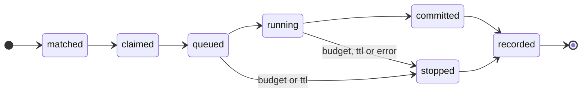

# Daemon

Runs the work that must happen while nobody is using Pi: timers, reactions to
Git changes, and queued spawns. One per machine, as a user service.

## Responsibilities

| Area | Behaviour |
|---|---|
| **Git events** | A `reference-transaction` hook installed in each registered vault notifies the daemon of ref updates; it also polls refs every minute as a fallback |
| **Timers** | Evaluates timer conditions each minute; applies `missed` on start |
| **Matching** | Derives events from each job's cursor up to the accepted `main` and matches `applies-when` conditions |
| **Integrity** | On every ref change, checks for an unaccepted change to `main`; pauses the vault's automation and notifies the owner once |
| **Claims** | Claims each spawn with a unique insert in the state database, so no spawn runs twice |
| **Scheduling** | Orders queued spawns by priority and runs them within each model's capacity |
| **Budgets** | Enforces document budgets, cascade pools and the installation's daily ceiling |
| **Execution** | Starts `pi --mode rpc` with the spawn's context: forked from the originating session when available, fresh otherwise |
| **Traces** | Issues trace IDs, writes full logs and rotates them |
| **Outbox** | Retries undelivered notifications with backoff |
| **Forge sync** | For `forge`-mode vaults: pushes actor branches, keeps pull requests and commit statuses current, fetches to detect merges |
| **MCP server** | Serves each configured MCP profile on its own endpoint — see [MCP](../mcp.md) |

## Spawn lifecycle

A spawn's identity is its document and the event that triggered it. The claim
is recorded before anything runs; a second claim for the same identity fails
and is ignored. Each state change is one transaction, so a crash leaves every
spawn in exactly one state.

## Catch-up

Events come from Git history, so nothing is lost while the daemon is down. On
start it derives events from each cursor up to the accepted `main` and
processes them in order.

## Hosting

Two independent settings decide which daemon runs a vault's timer and Git-event
jobs:

| Setting | Where | Default | Effect |
|---|---|---|---|
| `host` | The vault's entry in the installation config | `false` | This installation opts in to running the vault's jobs |
| `executor` | `vault.executor` in the vault's root contract | unset | Only the named installation may run the vault's jobs |

| `executor` | Runs on this installation when |
|---|---|
| unset | `host: true` |
| this installation's name | always |
| another installation's name | never — `vault doctor` warns if `host: true` is also set |

So nothing runs until someone opts in, and a vault can be pinned to one place
regardless of how many machines clone it.

An installation's name defaults to `<user>@<hostname>` and can be set in the
installation config. `vault whoami` prints it — the value to put in
`vault.executor`.

Spawns from interactive sessions always run on the machine of that session.

## Socket protocol

JSON lines over a local socket accessible only to the user (a Unix domain
socket; a named pipe on Windows).

| Method | Purpose |
|---|---|
| `ping` | Version and capabilities |
| `spawn` | Submit a spawn request |
| `status` | Queue, running sessions, budgets |
| `subscribe` | Receive start and finish notices for a session's spawns |
| `stop` | Stop a running spawn |

## Service installation

`vault daemon install` writes a definition for the platform:

| Platform | Service |
|---|---|
| Linux | systemd user unit |
| macOS | launchd agent (a launchd daemon with a user on headless machines) |
| Windows | Task Scheduler task at logon |

The service runs a launcher that resolves the current Node and `pi` at start,
so upgrades do not break it.

## Log rotation

Full logs are kept per day and trace. Today's files stay as written; files from
earlier days are gzip-compressed; days older than `logs.keep-days` (counting
today) are deleted. Days are UTC dates.
