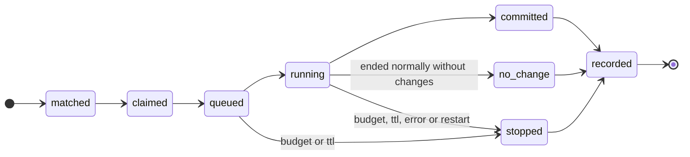

# Daemon

Runs the work that must happen while nobody is using Pi: timers, reactions to
Git changes, and queued spawns. One per machine, as a user service.

## Responsibilities

| Area | Behaviour |
|---|---|
| **Git events** | A `reference-transaction` hook installed in each registered vault (`vault doctor --fix`) notifies the daemon of ref updates, by leaving a file named after the vault in `<state>/refs`; it also polls refs every minute as a fallback |
| **Single instance** | Takes the daemon's record in the state database — its process ID and start time, void once that process ends — then binds its socket; if another daemon holds either, it does not run (and exits `0`, so a service manager does not restart it) |
| **Timers** | Evaluates timer conditions each minute, in the machine's time zone; applies `missed` on start. A timer run is identified by its local date and scheduled time, so a clock change (daylight saving) neither repeats nor skips it |
| **Matching** | Derives events from each job's cursor up to the accepted `main` and matches `applies-when` conditions (see Matching) |
| **Integrity** | On every ref change, checks for an unaccepted change to `main`; pauses the vault's automation and notifies the owner once |
| **Claims** | Claims each spawn with a unique insert in the state database, so no spawn runs twice |
| **Scheduling** | Orders queued spawns by priority and runs them within the model's capacity, one job per actor at a time (see Scheduling) |
| **Budgets** | Enforces document budgets, cascade pools and the installation's daily ceiling |
| **Execution** | Starts `pi --mode rpc` with the spawn's context: forked from the originating session when available, fresh otherwise |
| **Traces** | Issues trace IDs, writes full logs and rotates them |
| **Outbox** | Each minute, retries the undelivered notifications that are due, with backoff (see [Notifications](../notifications.md)) |
| **Forge sync** | For `forge`-mode vaults: pushes actor branches, keeps pull requests, commit statuses and the `vault/policy` status current, fetches to detect merges; merges attestation and trace notes line by line (see Forge sync) |
| **MCP server** | Serves each MCP profile that has an endpoint on it; one that cannot be served (its token unresolved, its address in use) is reported at start and the others still are — see [MCP](../mcp.md) |

## Spawn lifecycle



A spawn's identity is its document and the event that triggered it. The claim
is recorded before anything runs; a second claim for the same identity fails
and is ignored. Each state change is one transaction, so a crash leaves every
spawn in exactly one state. Besides `budget`, `ttl`, `error` and `restart`, a
spawn stops with `queue-time` (queued past `daemon.queue-time`), `requested`
(the socket's `stop`) or `no-session` (its condition says `session-required`
and the originating session is not known here).

## Matching

Each job keeps a cursor per stream of events: the merges on a vault's
accepted `main` (`merged`), and the commits on each actor branch
(`committed`). Events after the cursor are matched against the job's
conditions, their spawns claimed and the cursor moved past them, event by
event.

- A job seen for the first time starts at the merge that introduced it, when
  the daemon already scans the vault; in a vault the daemon takes up (newly
  registered or hosted), everything starts where its history is, so nothing
  before is replayed. An actor branch made since starts where it left the
  accepted `main`.
- A vault with an unaccepted change is neither a source nor a target of
  events while it is paused; its cursors wait, so its events are matched once
  it is resolved.
- A Git event is matched in parts, one per run whose changes it holds (their
  `Vault-Trace`); each part continues that run's tree when the run is known
  here, and otherwise starts a new one, and is a spawn identity of its own.
  The part no run made starts a new tree.
- A cursor whose commit has gone (rewritten history) starts again at the tip.

## Scheduling

Queued spawns start in the order of [Architecture](../architecture.md#scheduling),
at most `daemon.parallel` at a time — the capacity of the model Pi runs them
with — and one job per actor: an actor busy with a run, chosen for an earlier
spawn, or held by an interactive session waits, keeping its place. A spawn
names its actor from the claim (the job's `actor` on the accepted `main`).
Nothing starts for a vault with an unaccepted change.

```yaml
daemon:
  queue-time: 24h   # default; a spawn queued longer is stopped (queue-time)
  parallel: 1       # default; headless sessions at once
```

## Execution

A spawn runs as

```
pi --mode rpc --vault-run <state>/runs/<trace>.json --session-id <trace> [--fork <session file>]
```

in its actor's worktree, with the user's environment. The run file is the
one the extension reads ([Pi extension](extension.md#headless-sessions)). It
forks the originating session when that session is known here — it
subscribed, giving its session file — and the condition's `context` is not
`bare`. The daemon records the process (ID and start time) before anything
else, asks the session to begin, waits for Pi to settle and closes its
input. A run still going at its budget's `ttl` plus a minute is killed.

How it ended is read from what is recorded: commits on the actor's branch
carrying the run's trace make it `committed`; otherwise a used-up budget
(`budget`), its run time (`ttl`), a stop on request, a failed process, or a
last model request that ended in an error — Pi's last assistant message
stopped with `error`, such as an unreachable endpoint — (`error`) stop it; a
run that settled normally and committed nothing is `no-change`. A model error
after commits leaves the run `committed`, with the error recorded at its end.
Each step goes to the run's full log (`daemon`, its end with any `modelError`;
Pi's events in `pi`, without streaming deltas).

## Start-up recovery

Only one daemon runs, so nothing it started can still be legitimately running
when it starts. Before anything else it returns its own state to a clean slate:

1. Ends any headless session left from its previous run, by the exact process
   ID it recorded, after checking that process's start time so a reused ID is
   never touched. It never matches processes by name.
2. Marks every running spawn `stopped` with the reason `restart`, ending its
   budget session and releasing its actor.
3. Resets the worktree of each actor those spawns held to the actor's last
   commit, first saving any uncommitted changes to the run's full log.
4. Leaves queued spawns queued; they keep their queue-time limit.

Interactive Pi sessions are not the daemon's and are left alone: their actor
holds stay valid while their processes live.

`vault doctor --fix` runs the same recovery when no daemon is running. For
anything the daemon owns, restarting it is the remedy.

## Catch-up

Events come from Git history, so nothing is lost while the daemon is down. On
start, after recovery, it derives events from each cursor up to the accepted
`main` and processes them in order.

## Hosting

Two independent settings decide which daemon runs a vault's timer and Git-event
jobs:

| Setting | Where | Default | Effect |
|---|---|---|---|
| `host` | The vault's entry in the installation config | `false` | This installation opts in to running the vault's jobs |
| `executor` | `vault.executor` in the vault's root contract | unset | Only the named installation may run the vault's jobs |

| `executor` | Runs on this installation when |
|---|---|
| unset | `host: true` |
| this installation's name | always |
| another installation's name | never — `vault doctor` warns if `host: true` is also set |

So nothing runs until someone opts in, and a vault can be pinned to one place
regardless of how many machines clone it. The owners of a vault the daemon
runs are told of an unaccepted change once per unaccepted tip, when they are
recipient aliases in `notify`.

An installation's name defaults to `<user>@<hostname>` and can be set in the
installation config. `vault whoami` prints it — the value to put in
`vault.executor`.

Spawns from interactive sessions always run on the machine of that session.

## Forge sync

Each minute, before anything else, every `forge`-mode vault is fetched: the
forge's `main` becomes the accepted `main` and the local `main` follows it
forward, so a merge in the forge is matched like any other. For the vaults the
daemon runs, each of the vault's `actors` with a proposal has it kept current
at the forge: when its branch's head moves, the branch is pushed and its pull
request opened or updated, with its statuses; otherwise its statuses are
published again every five minutes, to pick up reviews made in the forge. A
failure is shown by `vault daemon status` and tried again the next minute.

For those vaults it also checks merges. Before fetching, it asks the forge
which pull requests from the vault's writers' branches were merged into `main`
most recently (one page). After fetching, it checks each one not checked before:
is its head an ancestor of the new accepted `main`? Asking first means each
merge named is in the `main` it is judged against. Each result is recorded
once. A head that is not in `main` — a squash or rebase merge — is reported by
`vault status` and `vault doctor` and told once to the owners, naming the pull
request and that its attestations and trace notes no longer attach.

## Socket protocol

JSON lines over a local socket accessible only to the user (a Unix domain
socket, `<state>/daemon.sock`; a named pipe on Windows, named after the state
directory). A request is `{ id, method, params }`, answered
`{ id, ok: true, result }` or `{ id, ok: false, error: { reason, … } }`.

| Method | Params | Result |
|---|---|---|
| `ping` | — | `version`, `capabilities` (the methods) |
| `spawn` | A spawn request: `vault`, `document`, `condition`, `event`, optional `parent` and `relevance` | The spawn as claimed |
| `status` | — | `queued`, `running` (with process IDs), `paused` vaults, `budgets` (`dailyUsed`, `dailyTokens`), `forge` (per vault: `at`, `accepted`, `proposed` actors, `error`) |
| `subscribe` | `trace`; optionally `session` and its `file` | — then notices for the spawns in that session's tree |
| `stop` | `trace` | — the running spawn is stopped (`requested`) |

A spawn request is claimed under its identity, but with its budget and actor
as the job on the accepted `main` has them, and only when the job's condition
at `condition` is a spawn condition the event matches (its script narrowing
it); otherwise it is refused, as it is for a paused vault. A notice is
`{ notice: "spawn", state, trace, vault, document, parent?, root?, outcome?,
reason?, commit? }`, with `state` `started` or `finished`.

## Service installation

`vault daemon install` writes a definition for the platform:

| Platform | Service |
|---|---|
| Linux | systemd user unit, `$XDG_CONFIG_HOME/systemd/user/pi-active-vaults.service` |
| macOS | launchd agent, `~/Library/LaunchAgents/pi-active-vaults.daemon.plist`; on a Mac nobody logs in to, `--headless`: a launchd daemon, `/Library/LaunchDaemons/pi-active-vaults.daemon.plist`, run as the user with their `HOME`, installed by the person with `sudo` |
| Windows | Task Scheduler task at logon, `pi-active-vaults`, registered with `schtasks` |

The service runs `vault daemon run` through the platform's shell (a login
shell on Linux and macOS), which resolves the current Node at start; the
daemon finds `pi` on `PATH` as it starts. So upgrades do not break it.

## Log rotation

Full logs are kept per day and trace. Today's files stay as written; files from
earlier days are gzip-compressed; days older than `logs.keep-days` (counting
today) are deleted. Days are UTC dates.
